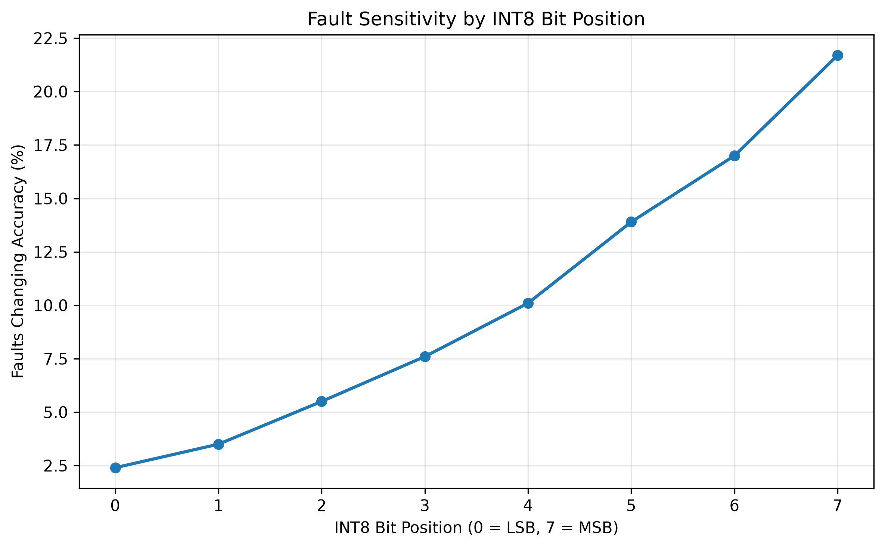
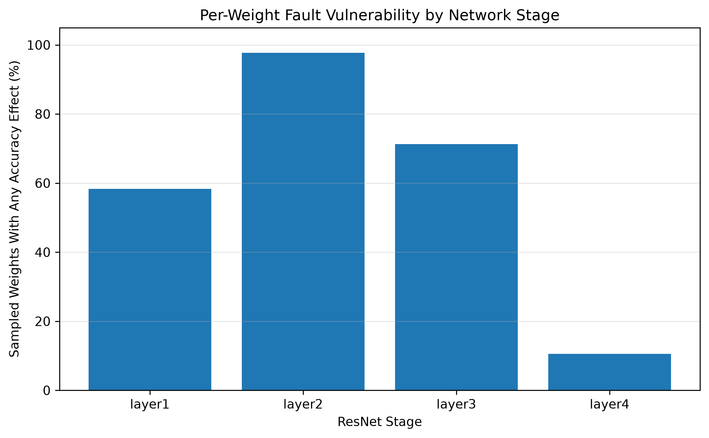

# INT8 ResNet-18 Reliability

How do single-bit faults in stored model weights affect a quantized image classifier? This project uses PyTorch to train ResNet-18 on CIFAR-10, apply static post-training INT8 quantization, and simulate bit flips in the quantized weights.

## Results

| Measurement | Result |
| --- | ---: |
| FP32 accuracy on the full CIFAR-10 test set | 94.35% |
| INT8 accuracy on the full CIFAR-10 test set | 94.26% |
| Single-bit fault tests | 8,000 |
| Sampled weight locations | 1,000 |
| Test images per fault | 2,500 |

Each of the eight bit positions was tested at the same 1,000 weight locations, one bit flip at a time. A flip in the most significant bit changed measured accuracy in 21.7% of tests, compared with 2.4% for the least significant bit. Sensitivity also varied by ResNet stage.





## Reproduce the analysis

From the repository root, install the notebook dependencies and launch JupyterLab:

```powershell
python -m pip install -r requirements.txt
python -m jupyterlab
```

Open [the notebook](resnet18_cifar10_fault_injection.ipynb), select the Python environment where you installed the dependencies, and run the cells under **Results** through **Visual summary of fault sensitivity**. The eight campaign CSVs are included, so this analysis needs neither a CIFAR-10 download nor a trained checkpoint.

## Rerun training and fault tests

Use a separate copy of the repository and remove the eight `fault_injection_BIT*.csv` result files from that copy before running the notebook from the beginning. The notebook downloads CIFAR-10, trains the FP32 model, writes a checkpoint, applies static INT8 quantization with PyTorch FX and oneDNN, and writes new campaign CSVs. The saved weight locations and image indices keep the sampling fixed. The fault tests run on CPU and can take many hours. The original run used Python 3.13 with CUDA available for FP32 training.

## Scope

The tests simulate one flipped bit in one stored weight at a time. The percentages describe changes in aggregate accuracy on the fixed 2,500-image subset. Results apply to this trained model and quantization setup. Stage-level sample sizes vary, so comparisons involving the smallest stage sample should be interpreted cautiously.
